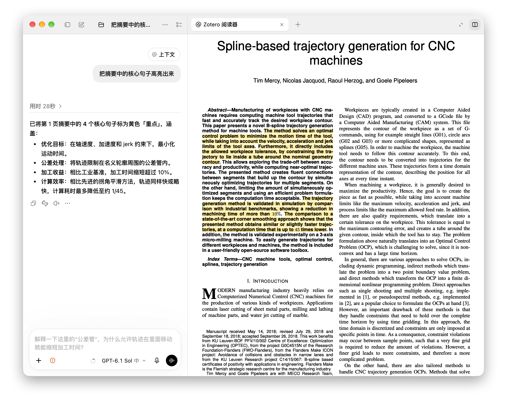

# Codex Zotero 阅读器

> **English.** A paper reader that lives in the Codex desktop app on macOS. It opens PDFs from your Zotero library in the Codex panel, renders them with Apple PDFKit, keeps highlights, comments and notes in Zotero, and lets Codex read the paper with you: ask about a selection, save answers as annotations, build a paper map, or be guided through the paper question by question. For technical users who build from source — see [INSTALL.md](INSTALL.md). The interface and docs are in Chinese.

在 Codex 桌面版里读 Zotero 论文：论文在 Codex 的面板中打开，对话就在旁边。选中一段就能问；回答可以存成 Zotero 批注；也可以让 Codex 带着一组精读问题，一步步引导你把论文读透。

所有批注、笔记都写回 Zotero，插件自己只在本机保存阅读位置和设置。



*对 Codex 说"把摘要中的核心句子高亮出来"，它读完摘要，直接在论文上标出四句并写回 Zotero。*

详细用法见 [使用指南](docs/USAGE.md)。

## 功能

**阅读**
- 用 macOS 的 PDFKit 渲染，像素对齐、裁掉白边、连续滚动、手势缩放；多标签页，关掉面板再打开会恢复原位。
- 页内查找、跳页；论文内的"式 (11)""图 7""[12]"可以点击跳转，悬停能预览目标处，⌥← / ⌥→ 返回、前进。
- 首页：搜索 Zotero 文库，列出在读的论文。

**版面块、上下文与按需 OCR**
- 默认使用本地 PP-DocLayoutV2 检测段落、公式、表格和图片，单击整块选择，⇧ 单击直接加入对话上下文。
- 工具条「加入上下文」可跨页保留多个块；底部可移除或清空，不自动发送问题。
- 顶栏「OCR」识别整篇，完整结果自动用于文字和版面块。全文由模型根据当前问题按需读取；连续对话复用相同版本，不随每次翻页附带全文。
- 首次运行 `npm run setup-analysis` 安装本地模型，在阅读器「设置 → MinerU 识别」填写 API key。见 [版面与 OCR 说明](docs/LAYOUT_OCR.md)。

**选择与提问**
- 双击选词、三击选整句（可跨行、跨栏），⌥ + 拖动框选公式或图。
- 选中后点"提问"，问题连同选段和原图一起发到对话里；公式以原图为准。

**批注（直接写入 Zotero）**
- 高亮、下划线、评论；颜色和标签在设置里自定义，按键 1–9 对应。
- 评论支持基础 Markdown 和 `$…$` 公式（KaTeX，与 Zotero 一致）。
- 删除与 Zotero 一致，⌘Z 可恢复；Zotero 没开时写入会排队，之后自动补写。
- 针对某一处的问答，Codex 回答后自动存成该处的批注（简短，只记核心）。

**笔记**
- 在面板里打开 Zotero 笔记：公式、表格、图片、目录；笔记里引用的高亮、页码可以点回论文原处。
- **论文地图**（你要求时才生成）：由 Codex CLI 调用模型通读全文，写一份带页码的导航笔记，存进 Zotero。
- **导读**：对 Codex 说"带我读这篇"，它会带着一组精读问题（可在设置里改）一步一步引导你思考；每读完一个问题，结论记进这篇论文的"精读笔记"，下次接着读。

**给 Codex 的工具**：`reader_state`、`paper_context`、`paper_outline`、`read_pages`、`find_in_paper`、`paper_map`、`reading_guide`、`list_annotations`、`annotate`、`search_annotations`、`read_notes`、`show_location`、`search_library` 等，配有一份 skill 说明何时用哪个。

## 环境要求

| 项目 | 说明 |
|---|---|
| macOS | 开发与测试于 macOS 27（Apple Silicon）。PDF 渲染依赖 PDFKit，只支持 macOS |
| Codex 桌面版 | 装在 `/Applications/ChatGPT.app`（位置不同可用环境变量指定） |
| Zotero | 测试于 Zotero 10.0.6；需要开启本地 API（设置 → 高级 → "允许此计算机上的其他应用程序与 Zotero 通信"） |
| Xcode 命令行工具 | 编译 PDFKit 辅助程序（`swiftc`）：`xcode-select --install` |
| Node.js 20+ 与 npm | 只在构建、安装时使用；插件运行用 Codex 自带的 Node |
| Python 3 + PyMuPDF | 可选，用于修复 PDF 文字中的连字和符号：`python3 -m pip install pymupdf fonttools`。没有它也能用 |

## 安装

```bash
git clone https://github.com/theigrams/codex-zotero.git
cd codex-zotero
npm install
npm run install-plugin
```

然后完全退出 Codex（⌘Q）再打开，对 Codex 说"打开 Zotero 阅读器"。

安装脚本会编译辅助程序、找到装了 PyMuPDF 的 Python、把笔记与公式用的字体（KaTeX、Lora）装进 `~/Library/Fonts`，并把插件注册到 Codex。每一步的说明、验证方法和常见问题见 [INSTALL.md](INSTALL.md)；也可以把 INSTALL.md 交给你的 agent，让它照着装。

## 使用

完整说明见 [docs/USAGE.md](docs/USAGE.md)，下面是最常用的几项。


- 打开论文：对 Codex 说"打开那篇关于……的论文"，或在阅读器首页搜索。
- 设置：⌘,（渲染方式、批注颜色与标签、快捷键、论文地图的模型 / 推理强度 / 提示词、精读问题）。
- 常用按键：H 高亮、1–9 换颜色（加 ⇧ 为下划线）、A 批注抽屉、G 跳页、⌘F 查找、⌥← / ⌥→ 返回 / 前进、=/-/0 缩放、C 裁边 / 原始页面、⌘Z 恢复刚删除的批注。除 1–9、Esc、⌘C、⌘1–9 外都可在设置里改。

## 数据与隐私

- 批注、笔记、论文地图、精读笔记都存在 Zotero 里；插件只通过 Zotero 的本地 API 读写，从不碰 Zotero 的数据库文件。
- 本机还保存：阅读位置、标签页、设置、待写入队列（`~/.codex/codex-zotero`），页面缓存（`~/Library/Caches/codex-zotero`）。
- 只有你主动要求整篇 OCR，或全局「允许模型按需识别」开启后模型发起识别，PDF 才会上传到 MinerU；API key 只保存在本机。阅读器只提供全文短引用，由模型通过工具读取正文；显式加入的块作为当前对话上下文。
- 你提问时，选段文字和原图截图会发到 Codex 对话里；生成论文地图时，论文全文会经 Codex CLI 发给模型（默认 `gpt-6.1-sol`）。这些都只在你主动操作时发生。

## 卸载

```bash
npm run uninstall-plugin
```

移除插件与插件市场；加 `-- --all` 同时删除本机的阅读状态和缓存。字体不会自动删除，脚本会列出它们的位置。

## 开发

见 [AGENTS.md](AGENTS.md)（构建、测试、代码约定）和 [docs/](docs/)（架构、渲染、配置）。

## 许可

MIT，见 [LICENSE](LICENSE)。第三方组件见 [THIRD_PARTY.md](THIRD_PARTY.md)。PyMuPDF（AGPL）不随本仓库分发，由你自行安装。
